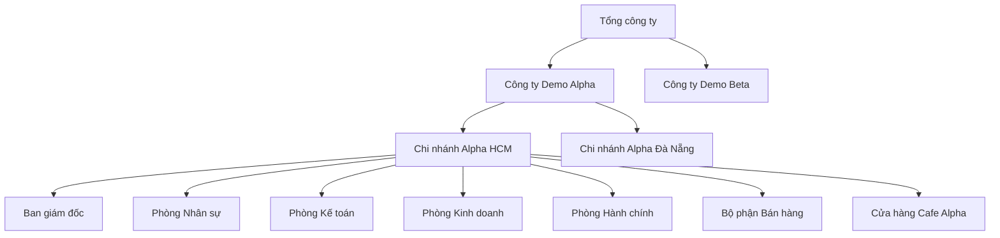

# Data demo tổ chức — Buổi 1

Dùng để học viên nhìn cây tổ chức và nhân sự khi thực hành chấm công.

---

## Sơ đồ

---

## Có những gì?

**Tổng công ty**
- Công ty Demo Alpha
- Công ty Demo Beta

**Trong Công ty Demo Alpha**
- Chi nhánh Alpha HCM *(đủ phòng ban, chức danh, nhân sự)*
- Chi nhánh Alpha Đà Nẵng *(chưa gắn phòng ban — để so sánh)*

**Công ty Demo Beta** — chưa có chi nhánh.

---

## Chi nhánh Alpha HCM — phòng ban & chức danh

| Phòng ban | Chức danh |
|-----------|-----------|
| Ban giám đốc | Giám đốc chi nhánh · Phó giám đốc |
| Phòng Nhân sự | Trưởng phòng Nhân sự · Nhân viên Nhân sự |
| Phòng Kế toán | Trưởng phòng Kế toán · Nhân viên Kế toán |
| Phòng Kinh doanh | Trưởng phòng Kinh doanh · Nhân viên Kinh doanh |
| Phòng Hành chính | Trưởng phòng Hành chính · Nhân viên Hành chính |
| Bộ phận Bán hàng | Quản lý cửa hàng · Nhân viên bán hàng |
| Cửa hàng Cafe Alpha | Quản lý cửa hàng Cafe · Phó quản lý cửa hàng Cafe · Barista · Thu ngân cửa hàng Cafe · Nhân viên phục vụ Cafe |

---

## Nhân sự demo (Chi nhánh Alpha HCM)

| Phòng ban | Họ tên | Chức danh |
|-----------|--------|-----------|
| Ban giám đốc | Nguyễn Văn Minh | Giám đốc chi nhánh |
| Ban giám đốc | Trần Thị Lan | Phó giám đốc |
| Phòng Nhân sự | Lê Hoàng Nam | Trưởng phòng Nhân sự |
| Phòng Nhân sự | Phạm Thị Hoa | Nhân viên Nhân sự |
| Phòng Kế toán | Hoàng Văn Đức | Trưởng phòng Kế toán |
| Phòng Kế toán | Võ Thị Mai | Nhân viên Kế toán |
| Phòng Kinh doanh | Đặng Quốc Huy | Trưởng phòng Kinh doanh |
| Phòng Kinh doanh | Bùi Thị Ngọc | Nhân viên Kinh doanh |
| Phòng Hành chính | Phan Văn Tuấn | Trưởng phòng Hành chính |
| Bộ phận Bán hàng | Ngô Thị Hạnh | Quản lý cửa hàng |
| Bộ phận Bán hàng | Đỗ Văn Khoa | Nhân viên bán hàng |
| Cửa hàng Cafe Alpha | Nguyễn Thị Hương | Quản lý cửa hàng Cafe |
| Cửa hàng Cafe Alpha | Lê Văn Phúc | Phó quản lý cửa hàng Cafe |
| Cửa hàng Cafe Alpha | Trần Minh Anh | Barista |
| Cửa hàng Cafe Alpha | Phạm Thị Trang | Barista |
| Cửa hàng Cafe Alpha | Hoàng Thị Yến | Thu ngân cửa hàng Cafe |
| Cửa hàng Cafe Alpha | Lý Thị Kim | Thu ngân cửa hàng Cafe |
| Cửa hàng Cafe Alpha | Mai Văn Sơn | Thu ngân cửa hàng Cafe |
| Cửa hàng Cafe Alpha | Võ Văn Long | Nhân viên phục vụ Cafe |
| Cửa hàng Cafe Alpha | Đỗ Thị My | Nhân viên phục vụ Cafe |
| Cửa hàng Cafe Alpha | Trịnh Thị Thảo | Nhân viên phục vụ Cafe |
| Cửa hàng Cafe Alpha | Huỳnh Văn Tài | Nhân viên phục vụ Cafe |
| Cửa hàng Cafe Alpha | Cao Thị Diễm | Nhân viên phục vụ Cafe |
| Cửa hàng Cafe Alpha | Dương Văn Bình | Nhân viên phục vụ Cafe |

---

## Ca làm việc (Công ty Demo Alpha)

| Ca | Giờ | Dùng cho |
|----|-----|----------|
| Ca hành chính sớm | 07:00 – 16:00 | Văn phòng — phân ca |
| Ca hành chính | 08:00 – 17:00 | Văn phòng — phân ca |
| Ca hành chính muộn | 09:00 – 18:00 | Văn phòng — phân ca |
| Ca Cafe sáng | 06:00 – 14:00 | Cửa hàng Cafe — ca sáng |
| Ca Cafe chiều | 14:00 – 22:00 | Cửa hàng Cafe — ca chiều |
| Ca Cafe tối | 22:00 – 06:00 *(qua đêm)* | Cửa hàng Cafe — ca tối |

Gợi ý demo nhiều ca cafe: chia thu ngân / phục vụ lần lượt vào sáng · chiều · tối.

---

## Văn phòng / địa điểm chấm công (Quận 1)

| Địa điểm | Địa chỉ | Cổng chấm công | Cách chấm |
|----------|---------|----------------|-----------|
| Tòa nhà Alpha Quận 1 | 12 Nguyễn Huệ, Bến Nghé, Q1 | Cổng chính · Lobi · Tầng hầm xe · Cổng phụ mặt sau | QR + kiểm tra vị trí (~100–120m) |
| Cửa hàng Cafe Alpha Quận 1 | 45 Lê Lợi, Bến Nghé, Q1 | Cổng Cafe Alpha Q1 | QR + kiểm tra vị trí (~80m) |

- Bảng công **Ban GĐ** / **Văn phòng** → chấm tại **Tòa nhà Alpha**  
- Bảng công **Cafe** → chấm tại **Cửa hàng Cafe**

---

## Bảng chấm công

| Bảng chấm công | Ai thuộc bảng | Ca | Check-in |
|----------------|---------------|----|----------|
| Ban giám đốc Alpha HCM | Nguyễn Văn Minh · Trần Thị Lan | HC sớm · HC · HC muộn | **Không bắt** check-in / check-out |
| Văn phòng Alpha HCM | NS · KT · KD · HC · Bán hàng *(9 người)* | HC sớm · HC · HC muộn | **Bắt buộc** tại Tòa nhà Alpha |
| Cafe Alpha | Toàn bộ NV Cafe *(13 người)* | Sáng · Chiều · Tối | **Bắt buộc theo ca** tại Cafe Q1 |

### Mẫu bảng công (3 mẫu — mỗi loại một thiết kế)

| Mẫu | Dùng cho | Cột chính |
|-----|----------|-----------|
| Mẫu Ban giám đốc | Không chấm cổng | NV, ngày, ca, điểm công, nghỉ |
| Mẫu Văn phòng | Chấm theo ngày (HC) | NV, ngày, ca, vào/ra, trễ/sớm, phút công, điểm, nghỉ, cộng/trừ |
| Mẫu Cafe | Chấm theo ca (sáng/chiều/tối) | NV, ngày, mã/tên ca, qua đêm, vào/ra, số log, trễ/sớm, phút/giờ công, điểm, nghỉ, cộng/trừ |

---

## Phân ca & check-in Cafe (tháng 11/2026)

- **Phân ca:** cả tháng 11 cho NV Cafe — xoay **sáng / chiều / tối** (mỗi ca ~4–5 người: QL/PQL, barista, thu ngân, phục vụ).
- **Nhật ký check-in:** từ **01/11 → 21/11** tại cổng Cafe Alpha Q1 (QR + tọa độ). Ca chưa tới giờ trong ngày hôm nay thì chưa có log.

---

## Gợi ý khi thực hành

1. Chọn **Công ty Demo Alpha → Chi nhánh Alpha HCM**.
2. Mở **Phân ca** bảng Cafe Alpha — xem lịch tháng 11.
3. Mở **Nhật ký check-in / Timesheet log** — đối soát đến hôm nay.
4. Ban GĐ không chấm cổng; văn phòng & cafe có chấm.
5. Chi nhánh Đà Nẵng / Công ty Beta dùng khi cần so sánh tổ chức chưa setup đủ.
