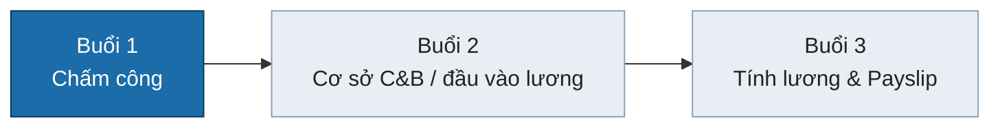
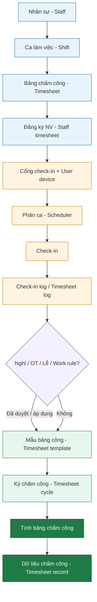
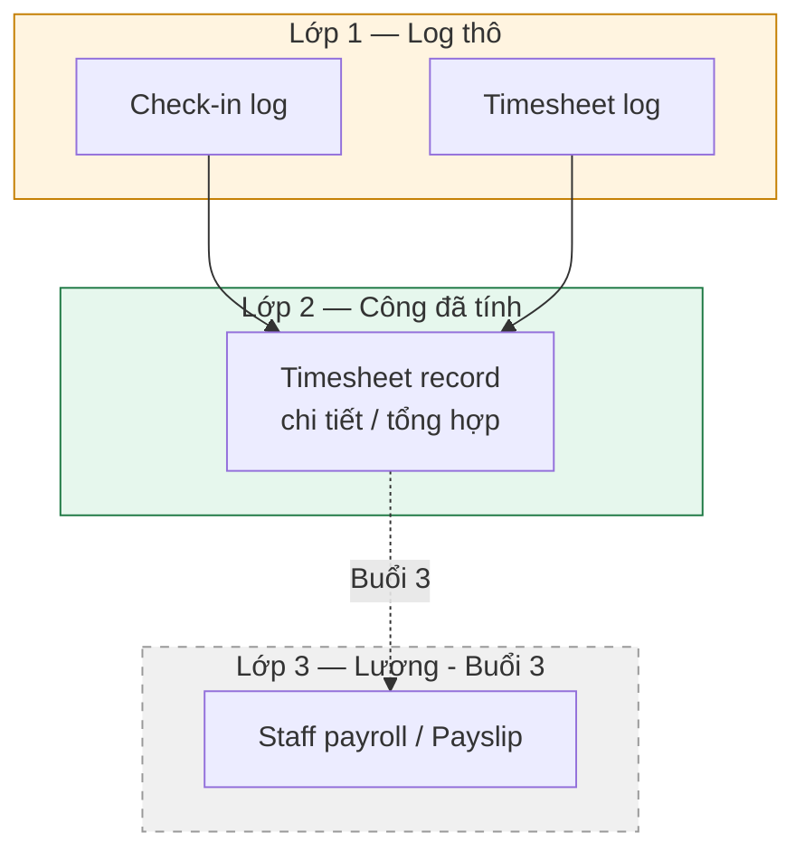
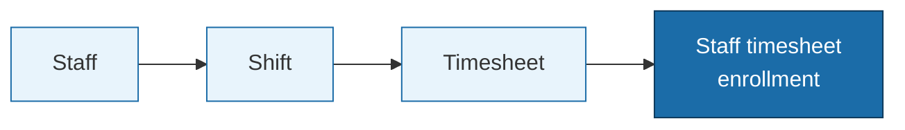
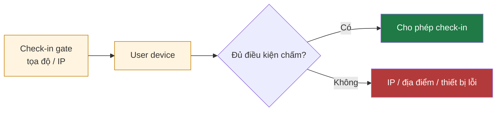
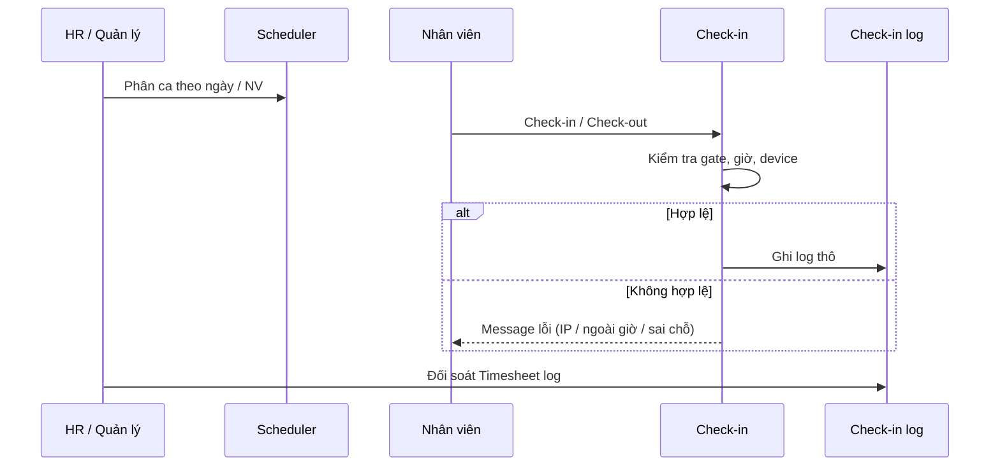
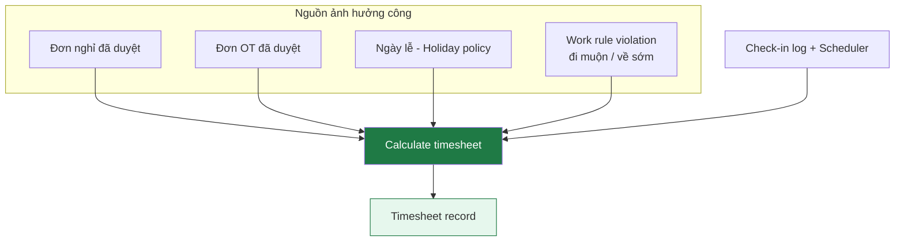
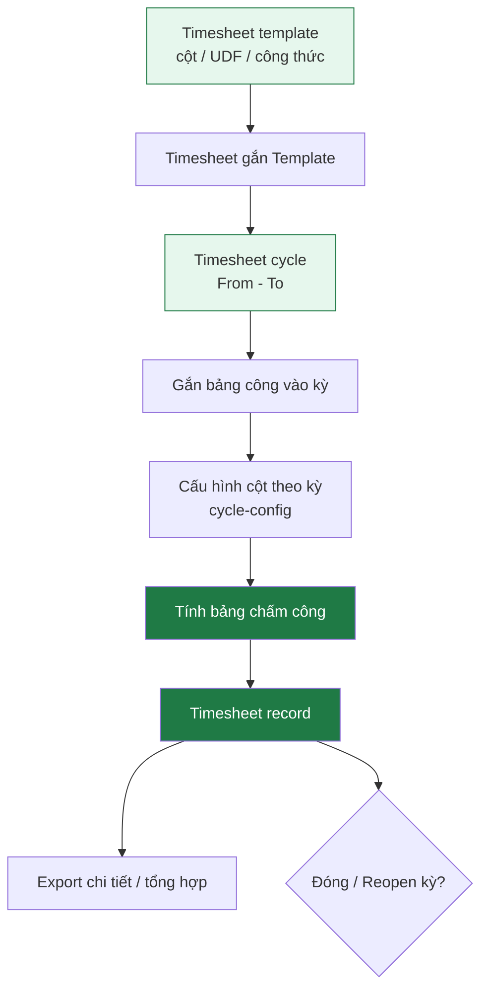
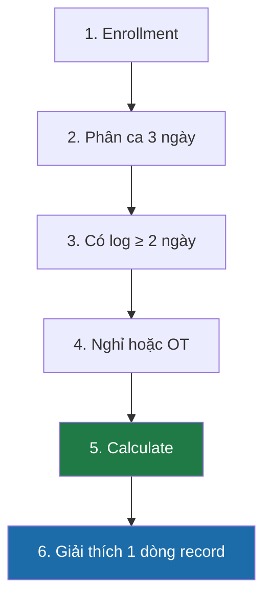

# HRM — Buổi 1: Chấm công end-to-end

| | |
|---|---|
| **Thời lượng** | 3.5–4 giờ |
| **Mục tiêu** | Setup → chấm → tính được bảng công kỳ mẫu |
| **Output** | 1 kỳ đã **Tính bảng chấm công**, có **Dữ liệu chấm công** đối soát được |
| **Không làm** | C&B, thuế, BH, payroll (Buổi 2–3) |

---

## 1. Vị trí buổi 1 trong lộ trình 3 buổi

---

## 2. Sơ đồ luồng nghiệp vụ buổi 1

### Thứ tự demo bắt buộc (đừng đảo)

`Staff → Shift → Timesheet (+ enrollment) → Gate/Device → Scheduler → Check-in → Template → Cycle → Calculate → Record`

---

## 3. Ba lớp dữ liệu cần phân biệt

| Lớp | Ý nghĩa | Buổi |
|-----|---------|------|
| Log thô | Giờ vào/ra thực tế | 1 |
| Công đã tính | Số công, OT, đi muộn… sau **Calculate** | 1 |
| Lương | Áp C&B + công thức payroll | 3 |

---

## 4. Agenda

| # | Phần | Thời lượng | Output checkpoint |
|---|------|------------|-------------------|
| 0 | Khai mạc + sơ đồ luồng | 15' | Học viên nắm end-to-end |
| 1 | Master chấm công | 50' | Shift + Timesheet + Enrollment |
| 2 | Cổng & thiết bị | 25' | Gate (+ device) sẵn |
| 3 | Phân ca & chấm thực tế | 45' | Có ca + có log trong kỳ |
| 4 | Nghỉ / OT / lễ / work rule (góc công) | 30' | Biết nguồn nào đổ vào tính công |
| 5 | Mẫu công → kỳ → tính công | 55' | Kỳ đã calculate + có record |
| 6 | Lab + checklist + Q&A | 30–40' | Lab pass + checklist tick đủ |

```mermaid
gantt
  title Buổi 1 — Timeline gợi ý
  dateFormat mm
  axisFormat %M'

  section Khai mạc
  Sơ đồ luồng           :a0, 00, 15m

  section Setup
  Master chấm công      :a1, after a0, 50m
  Cổng và thiết bị      :a2, after a1, 25m

  section Vận hành
  Phân ca và check-in   :a3, after a2, 45m
  Nghỉ OT lễ work rule  :a4, after a3, 30m

  section Tính công
  Template kỳ Calculate :a5, after a4, 55m
  Lab checklist Q&A     :a6, after a5, 35m
```

---

## 5. Chuẩn bị trước buổi

- Môi trường demo + 2–3 NV test  
- 1 chi nhánh / workplace có tọa độ hoặc IP gate  
- Data mẫu: 1 ca HC (VD 08:00–17:00) nếu muốn rút phần setup  
- Quyền menu HRM liên quan buổi 1:

| Route / màn | Tên VN |
|-------------|--------|
| `staff` | Nhân sự |
| `shift` | Ca làm việc |
| `timesheet` | Bảng chấm công |
| `staff-timesheet` | Bảng chấm công nhân viên |
| `checkin-gate` | Cổng check-in |
| `user-device` | Thiết bị người dùng |
| `scheduler` | Phân ca làm việc |
| `checkin` | Check-in |
| `checkin-log` | Nhật ký check-in |
| `timesheet-log` | Timesheet log |
| `leave-type` / `staff-time-off-request` | Loại nghỉ / Đơn nghỉ |
| `overtime-policy` / `overtime-request` | Chính sách OT / Phiếu OT |
| `holiday-policy` | Chính sách nghỉ lễ |
| `work-rule` (+ group / violation) | Quy định làm việc |
| `timesheet-template` | Mẫu bảng công |
| `timesheet-cycle` | Kỳ chấm công |
| `timesheet-record` | Dữ liệu chấm công |

---

## 6. Nội dung chi tiết theo phần

### 0. Khai mạc (15')

**Giảng**
- Mục tiêu buổi & output  
- Sơ đồ mục §2  
- Phân biệt log thô / công đã tính / lương (§3)

**Demo:** Chỉ menu HRM liên quan — chưa click sâu.

---

### 1. Master chấm công (50')

#### 1.1 Nhân sự — `staff` (10')
- Field ảnh hưởng chấm: chi nhánh, workplace, trạng thái, gắn user  
- NV nghỉ việc / chưa active → không vào bảng công  

#### 1.2 Ca làm việc — `shift` (15')
- Giờ vào–ra, loại ca, nghỉ giữa ca  
- Mã ca không trùng loại nghỉ  

#### 1.3 Bảng chấm công — `timesheet` (15')
Trên detail nhấn mạnh:
- **Template** (`IDTimesheetTemplate`)  
- **Check-in policy**  
- **Shift list**  
- Workplace / office  
- Số ca/ngày, giờ công/ngày  
- **Check-out required**  

#### 1.4 Đăng ký NV — `staff-timesheet` (10')
- Ai thuộc bảng công nào, khoảng thời gian  
- **Thiếu enrollment** = có log vẫn có thể không ra dòng công  

**Checkpoint:** Có Shift + Timesheet + Staff enrollment.

---

### 2. Cổng & thiết bị (25')

#### 2.1 Cổng — `checkin-gate` (15')
- Tọa độ, bán kính, IP wifi công ty  
- Lỗi hay gặp: IP invalid, phải chấm đúng địa điểm  

#### 2.2 Thiết bị — `user-device` (10')
- Đăng ký / duyệt thiết bị (nếu policy yêu cầu)  

**Checkpoint:** Gate (+ device nếu bắt buộc) sẵn sàng.

---

### 3. Phân ca & chấm thực tế (45')

#### 3.1 Phân ca — `scheduler` (20')
- Gán ca theo ngày / NV / bảng công  
- Chưa phân ca vs đã phân ca: ảnh hưởng đi muộn / về sớm  

#### 3.2 Check-in — `checkin` (10')
- Vào / ra; đúng chỗ, đúng giờ; checkout bắt buộc hay không  
- Demo 1 case success + 1 case fail  

#### 3.3 Nhật ký — `checkin-log` + `timesheet-log` (15')
- Check-in log = dữ liệu thô  
- Timesheet log = góc đối soát theo công  
- Bổ sung / sửa log khi quên chấm *(đúng quy trình công ty)*  

**Checkpoint:** Có phân ca + có log trong kỳ.

---

### 4. Nghỉ / OT / lễ / work rule — góc công (30')

> Không đi sâu C&B. Chỉ: **đã duyệt / áp dụng thì công tính thế nào**.

| Chủ đề | Màn hình | Nội dung giảng (gọn) |
|--------|----------|----------------------|
| Loại nghỉ / đơn nghỉ | `leave-type`, `staff-time-off-request` | Nghỉ duyệt → trừ công / công phép |
| PTO | `paid-time-off-policy`, `ptos-enrollment` | Nhắc enrollment; chi tiết Buổi 2 |
| OT | `overtime-policy`, `overtime-request` | OT duyệt → giờ OT vào công |
| Ngày lễ | `holiday-policy` | Ngày lễ vs ngày thường |
| Work rule | `work-rule`, group, violation | Đi muộn / về sớm → violation / trừ công |

**Demo gợi ý (chọn 2/3):** 1 đơn nghỉ duyệt · 1 đơn OT duyệt · 1 ngày lễ trên policy.

**Checkpoint:** Học viên biết nguồn nào “đổ” vào tính công.

---

### 5. Mẫu công → kỳ → tính công (55')

#### 5.1 Mẫu bảng công — `timesheet-template` (15')
- Cột công, UDF  
- Template gắn vào Timesheet  
- Đổi template / reload cột giữa kỳ → rủi ro lệch dữ liệu  

#### 5.2 Kỳ chấm công — `timesheet-cycle` (20')
- Tạo kỳ From–To  
- Chọn working schedule / bảng công  
- Cấu hình cột theo kỳ (nút options / cycle-config)  
- Message cần biết:
  - *Timesheet is not attached to this cycle*
  - *No timesheet cycle found for this date*
  - *No timesheet template available*

#### 5.3 Calculate + Record (15')
- Action **Tính bảng chấm công**  
- Xem **Timesheet record** (chi tiết / tổng hợp)  
- Export; reopen kỳ khi cần sửa bộ cột đã đóng băng  

#### 5.4 Đối soát nhanh (5')

**Checkpoint:** Kỳ đã calculate; có record xuất được.

---

## 7. Lab thực hành (30–40')

1. Gắn 1 NV vào bảng công  
2. Phân ca 3 ngày  
3. Ít nhất 2 ngày có log  
4. 1 ngày có nghỉ hoặc OT *(tuỳ data)*  
5. Tính công kỳ  
6. Đọc 1 dòng record và giải thích số liệu  

---

## 8. Checklist chốt buổi 1

- [ ] Shift hợp lệ  
- [ ] Timesheet có template + shift list + policy  
- [ ] Staff timesheet enrollment đủ  
- [ ] Gate (+ device nếu cần)  
- [ ] Scheduler có ca trong kỳ  
- [ ] Có check-in log  
- [ ] Nghỉ / OT / lễ liên quan đã duyệt *(nếu có)*  
- [ ] Timesheet cycle gắn đúng bảng công  
- [ ] Đã **Calculate timesheet**  
- [ ] Timesheet record đối soát OK  

---

## 9. Lỗi thường gặp

| Triệu chứng | Nguyên nhân thường gặp |
|-------------|------------------------|
| Không tính được công | Thiếu kỳ / bảng công chưa gắn kỳ |
| Có log nhưng không ra dòng NV | Thiếu staff-timesheet enrollment |
| Check-in fail | Sai IP, sai địa điểm, ngoài giờ, device chưa duyệt |
| Công lệch giờ | Chưa phân ca / sai ca / quên checkout |
| Thiếu OT / nghỉ trên record | Đơn chưa duyệt trước khi calculate |
| Lệch cột sau khi tính | Đổi / reload template giữa kỳ |

---

## 10. Tài liệu phát học viên

1. File này (sơ đồ + checklist)  
2. Bảng màn hình ↔ việc cần làm (§5)  
3. 5 screenshot gợi ý: Timesheet detail · Scheduler · Check-in log · Cycle calculate · Timesheet record  

---

## Liên kết lộ trình

| Buổi | Folder | Nội dung |
|------|--------|----------|
| 1 | `.userguide/HRM/Nội dung buổi 1/` | Chấm công *(file này)* |
| 2 | *(sẽ tạo)* | Cơ sở C&B — thuế — BH — HĐ — PTO — payroll template/config |
| 3 | *(sẽ tạo)* | Tính lương & Payslip |
